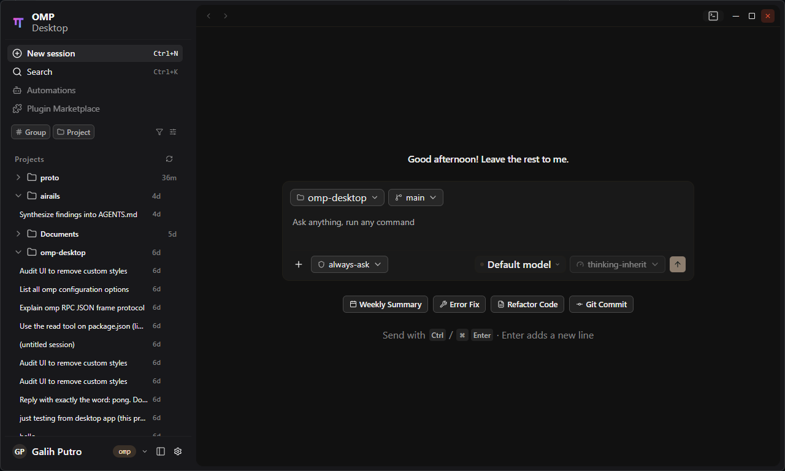

# OMP Desktop

A desktop shell for the `omp` CLI coding agent. OMP Desktop launches `omp` sessions, streams their RPC output into a native chat workspace, and keeps terminals and git close at hand.



> **Status: early development.** Primarily built for Windows (WebView2). Usable for day-to-day session work, but expect rough edges and breaking changes.

## Features

- **Chat workspace** — start `omp` sessions and watch their output stream in live: messages, tool cards, and todo updates rendered as they arrive.
- **Session management** — browse previous agent sessions, resume them, and get a clear warning when a session is already running in another `omp` process.
- **Embedded terminals** — PTY-backed terminal panels, side by side with the conversation.
- **Git integration** — repository status, branch listing, and a commit dialog wired to the active session.
- **Composer controls** — choose the model, thinking level, and approval mode when starting a session; queue prompts while the agent is busy.
- **Permissions UI** — an approval dock surfaces permission requests so you can respond without losing context.
- **Theming** — light and dark appearances with a custom frameless window chrome.

## Tech stack

- **Backend:** Go 1.25 and [Wails v2](https://wails.io) — spawns and supervises the `omp` process and exposes typed methods to the frontend.
- **Frontend:** React 19, TypeScript, Vite, Tailwind CSS v4, shadcn/Base UI primitives, chat UI components adapted from Vercel's ai-elements (streamdown), and xterm.js for terminals.

## Requirements

- Windows 10/11 with WebView2 (primary — and currently the only tested — platform)
- Go 1.25+
- Node.js 20+ (npm)
- [Wails CLI](https://wails.io/docs/gettingstarted/installation) v2:

  ```sh
  go install github.com/wailsapp/wails/v2/cmd/wails@v2.16.0
  ```

- The `omp` CLI available on your `PATH` — OMP Desktop runs it as a subprocess and does not bundle it.

## Getting started

From the repo root:

```sh
wails dev
```

This runs the Go backend together with the Vite dev server (hot reload). A browser-based dev server is also available at http://localhost:34115, where the Go methods are callable from devtools.

## Building

```sh
wails build
```

The production binary is written to `build/bin/`.

## Testing

```sh
go test ./...
go vet ./...
```

The Go build embeds `frontend/dist`, so on a clean checkout build the frontend once before running Go commands:

```sh
cd frontend
npm install
npm run build
```

`npm run build` also runs the TypeScript typecheck (`tsc`).

## Project structure

```
├─ main.go, app.go        # Wails entry point and app bindings
├─ rpc.go                 # omp RPC bridge (spawn, stream, send, stop)
├─ sessions.go            # session listing, transcripts, branches, models
├─ session_in_use.go      # cross-process session-conflict detection
├─ terminal.go, shell.go  # embedded terminals and shell helpers
├─ git.go                 # git status helpers
├─ frontend/              # React + Vite app (src/), generated Wails bindings (wailsjs/)
├─ build/                 # packaging assets (icons, manifests, installer)
└─ wireframes/            # low-fidelity UI prototypes (not part of the app build)
```

## Contributing

Contributions are welcome — see [CONTRIBUTING.md](CONTRIBUTING.md). For architecture notes and repository conventions (written for AI coding agents, but useful for humans too), see [AGENTS.md](AGENTS.md).

## License

Released under the [MIT License](LICENSE).

## Acknowledgements

Built with [Wails](https://wails.io). UI primitives from [shadcn](https://ui.shadcn.com); chat components adapted from [Vercel's ai-elements](https://github.com/vercel/ai-elements); message rendering by [streamdown](https://github.com/vercel/streamdown); terminals by [xterm.js](https://github.com/xtermjs/xterm.js) and [go-pty](https://github.com/aymanbagabas/go-pty). Geist font via [Fontsource](https://fontsource.org).
